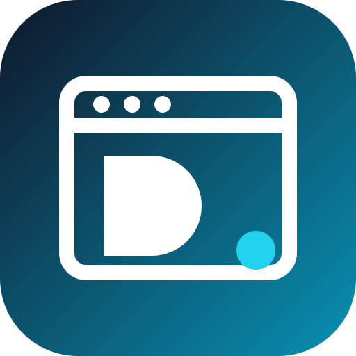
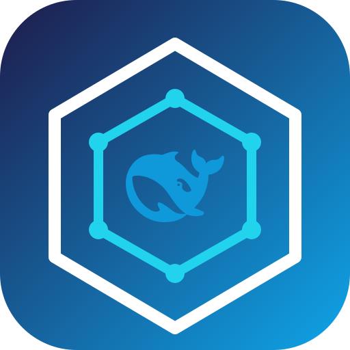
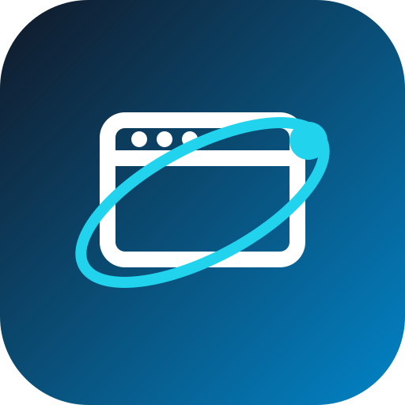
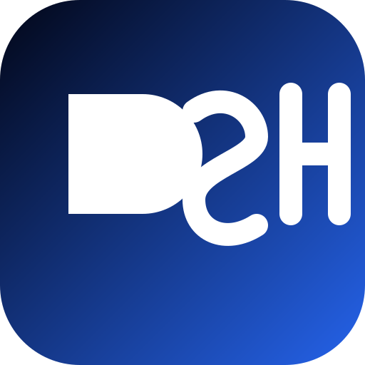

# DSH WebView Logo Ideas

Four SVG logo concepts for the wrapper app. They all use a DeepSeek/DSH blue-cyan palette and are designed to read clearly at small sizes (taskbar, tray icon, Start Menu).

## 1. Viewport D

- A browser window with a bold **D** inside.
- The cyan dot in the corner hints at the system-tray / background-running behavior.
- Best if you want the logo to instantly communicate “web wrapper.”

## 2. Hex Harness ✅ Selected

- Hexagon frame with circuit nodes and the DeepSeek logo at the center.
- Suggests a harness, network, or connected system.
- This is the concept currently used for the app icon set in `src-tauri/icons/`.
- A 512×512 render preview is also here as `hex-harness-512.png`.

## 3. Orbit Tray

- A browser window orbited by a cyan dot.
- Emphasizes that the app stays alive in the background tray.
- Modern and dynamic; works well animated.

## 4. DSH Mark

- Minimal lettermark using **D-S-H**.
- Clean and type-driven; easy to recognize at any size.
- Pick this if you prefer a brand-first look over an illustration.

## Suggested usage

| Size | Recommendation |
|------|----------------|
| 16×16 / 32×32 tray icon | **Viewport D** or **DSH Mark** — simple shapes stay readable. |
| 128×128 / 256×256 app icon | Any concept; add the gradient background. |
| Start Menu tile | **DSH Mark** or **Viewport D** for clarity. |
| Splash / about dialog | **Orbit Tray** or **Hex Harness** for visual interest. |

## Next steps

1. ~~Pick a concept~~ — Hex Harness is selected.
2. ~~Convert to icon sizes~~ — Done via `cargo tauri icon hex-harness.svg`.
3. ~~Replace placeholders in `src-tauri/icons/`~~ — Done.
4. ~~Re-run `build-wrapper.bat`~~ — Done; the release EXE now carries the new icon.

If you want to tweak the logo later, edit `hex-harness.svg` and re-run `cargo tauri icon hex-harness.svg` from `src-tauri`.
